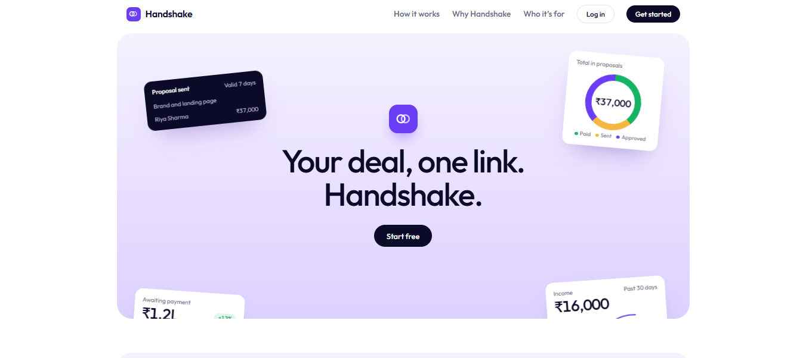
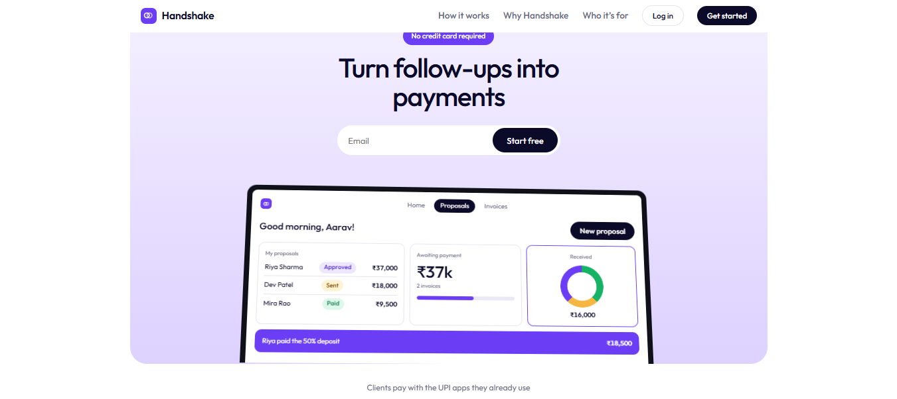
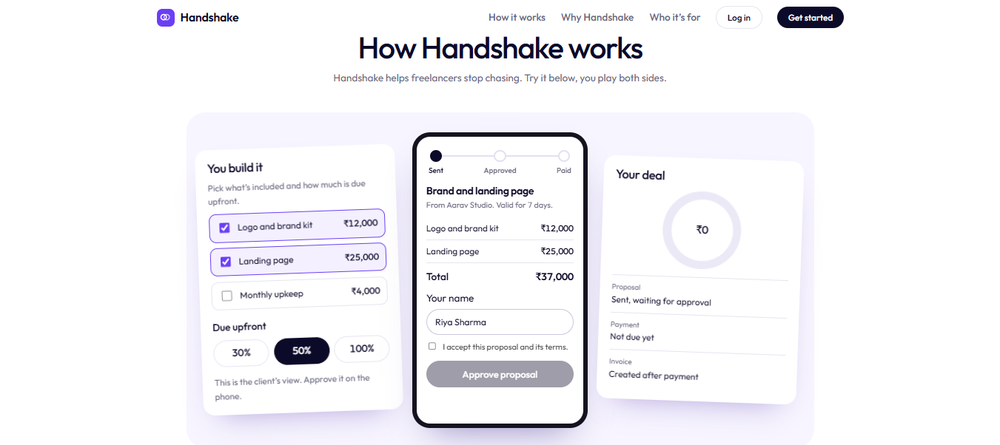
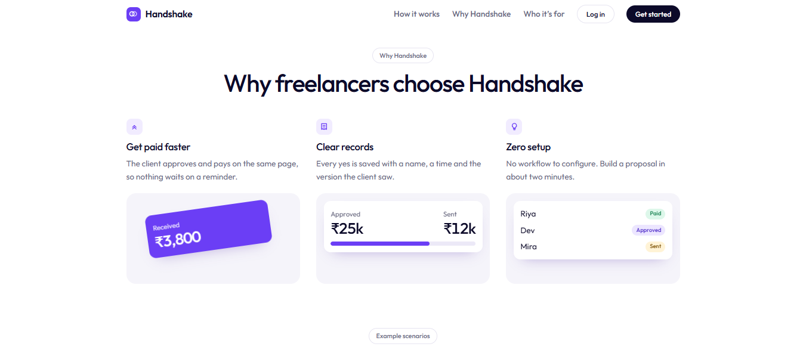
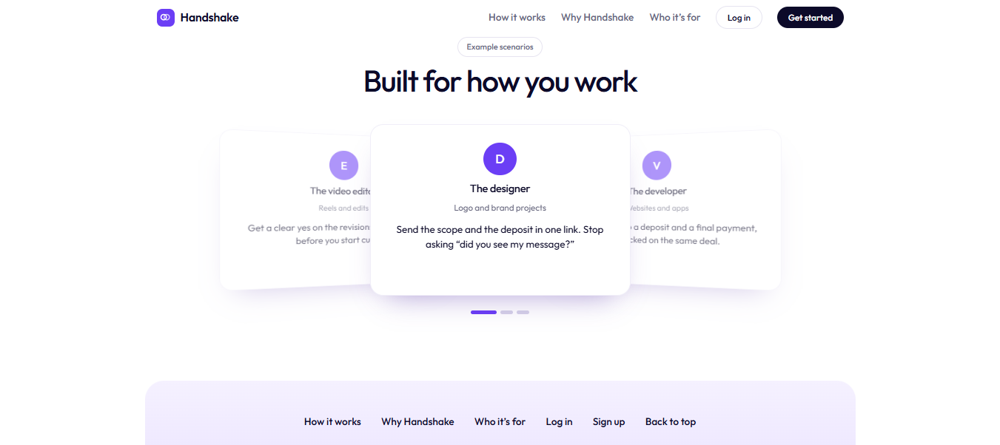
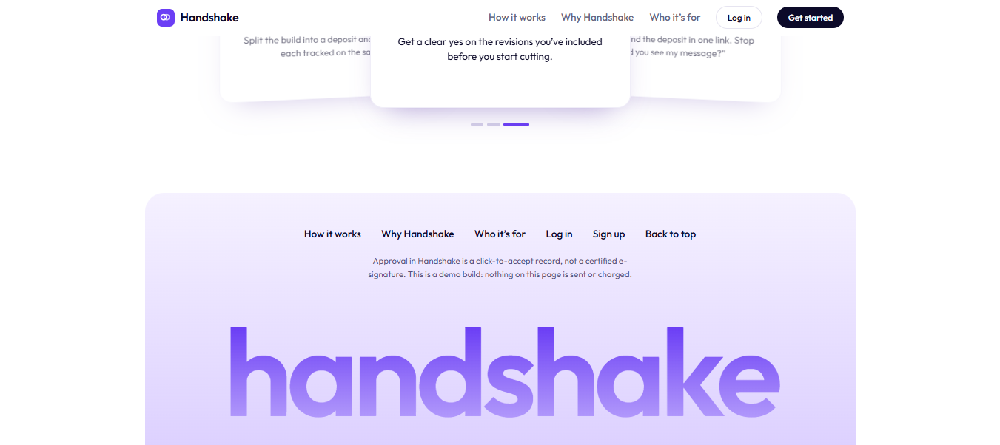

# Handshake SaaS

**Your deal, one link.** Handshake helps freelancers send a proposal, get a clear approval, and collect payment from the same page, so there is no more chasing clients.



## Screenshots

| | |
|---|---|
|  |  |
|  |  |



## Features

- Build a proposal with line items and choose the upfront amount (30%, 50% or 100%)
- Client approves on a single shareable link, with name and time recorded
- Dashboard with proposals, awaiting payment and income
- Auth with JWT cookies, rate limiting and Helmet security headers

## Setup

1. `npm install`
2. Copy `.env.example` to `.env`, then set `MONGODB_URI` (MongoDB Atlas free tier works) and `JWT_SECRET`.
3. `npm start`, then open http://localhost:3000

The Express server serves the `client/` folder and the API (`/api/...`) on the same origin, so no CORS setup is needed.

## Project structure

```
handshake-saas/
├── client/                 # Frontend (static files)
│   ├── index.html
│   ├── css/styles.css
│   └── js/
│       ├── landing.js      # Landing page animations and demo
│       └── app.js          # Auth, dashboard, proposals
├── server/                 # Backend (Node + Express + MongoDB)
│   ├── server.js           # App entry point
│   ├── config.js           # Env vars and constants
│   ├── utils.js            # Shared helpers
│   ├── models/             # User.js, Deal.js
│   ├── middleware/auth.js  # JWT auth and role checks
│   └── routes/             # auth.js, deals.js, billing.js
├── docs/screenshots/
├── package.json
└── .env.example
```

## Future updates

- **Payment gateway integration (Razorpay) is planned.** Right now the app shows **demo data** and no real payments are sent or charged.
- Real UPI payments for deposits and final payments
- Auto-generated invoices after payment

Before real customers: connect Razorpay (see the TODO notes in `server/routes/deals.js` and `server/routes/billing.js`), remove `DEMO_BILLING`, and deploy behind HTTPS with `NODE_ENV=production`.

> Approval in Handshake is a click-to-accept record, not a certified e-signature.
